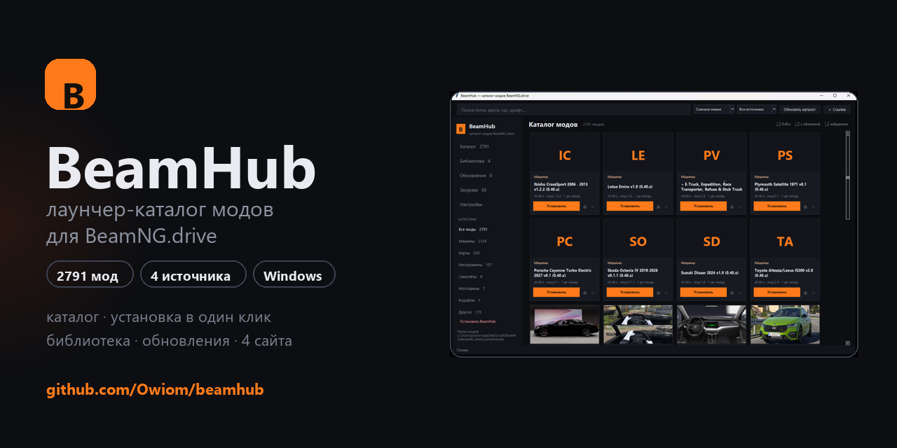
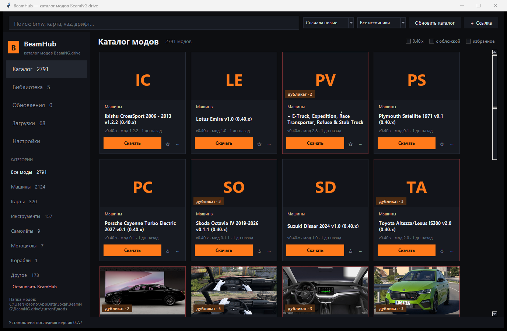

# BeamHub — mod catalog & launcher for BeamNG.drive

**One catalog instead of ten file‑hosting tabs.** Find a mod, press *Download*: the page opens, your browser fetches the archive (the sites won't hand files to a script), and BeamHub picks it up from the Downloads folder, validates it and copies it into the game's `mods`. From there: library, enable/disable, update checks.

## Features

- **2791 mods from 4 sites** — modsgaming.ru, playground.ru, beamngland.com, beamngmods.net — in a single window.
- **Categories & sorting** — cars, maps, tools, planes, bikes; newest, by name, by size, by popularity.
- **Search** with filters: game version `0.40.x`, “with cover”, “favorites”.
- **Download once, installed automatically** — you press *Download*, the browser fetches the file, and BeamHub validates the archive, strips a wrapper folder, dedupes by SHA‑256 and copies it into the game.
- **Duplicate detection** — the same mod from different sites is marked in the catalog and highlighted in the library.
- **Library** — enable / disable / delete, “update available” badges.
- **Favorites** and a dedicated **Updates** tab.
- **Add any URL** — paste a mod page link.
- **Self‑update** via GitHub Releases with SHA‑256 verification.

## Install

1. Download the [latest release](https://github.com/Owiom/beamhub/releases/latest) — `BeamHub-vX.Y.Z-win64-portable.zip`.
2. Extract the whole archive (the `_internal` folder must stay next to `BeamHub.exe`).
3. Run `BeamHub\BeamHub.exe`.

No Python required — the runtime is bundled.

> Windows SmartScreen may warn about an unknown publisher; that's normal for an unsigned, self‑built PyInstaller app. Choose *More info → Run anyway*.

## How installing works

1. Press **Install** — the mod page opens in your browser (sites only hand out files to a real browser behind Cloudflare).
2. Click **Download** there.
3. BeamHub watches the Downloads folder: validates the zip, strips a wrapper folder if needed, hashes it, and copies it into the game's `mods` directory.

Already downloaded archives are listed under **Downloads** and install with one click.

## Security

The app is local‑only: the HTTP server binds to `127.0.0.1`. The API is hardened against CSRF, DNS rebinding, SSRF and path traversal — see [SECURITY.md](SECURITY.md). Note that **mods are Lua code**; BeamHub validates archive structure, not contents.

## Roadmap

- [x] four catalogs, search and filters
- [x] install, library, enable/disable
- [x] duplicates, favorites, mod updates
- [x] self‑update
- [ ] mod collections / server profiles
- [ ] screenshot gallery
- [ ] silent mod updates

## Contributing

Bug reports, ideas and new catalog providers are welcome — see [CONTRIBUTING.md](CONTRIBUTING.md).

Русская версия: [README.md](README.md)

## Disclaimer

BeamHub is an unofficial project and is not affiliated with BeamNG GmbH. All mods belong to their authors; the app only stores links to public pages and downloads files under the same conditions as a browser. Licensed under [MIT](LICENSE).
