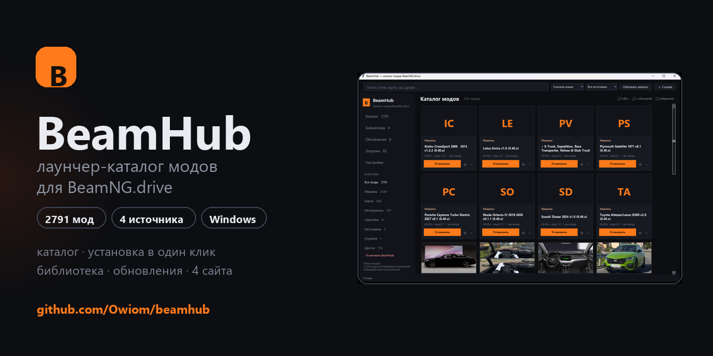
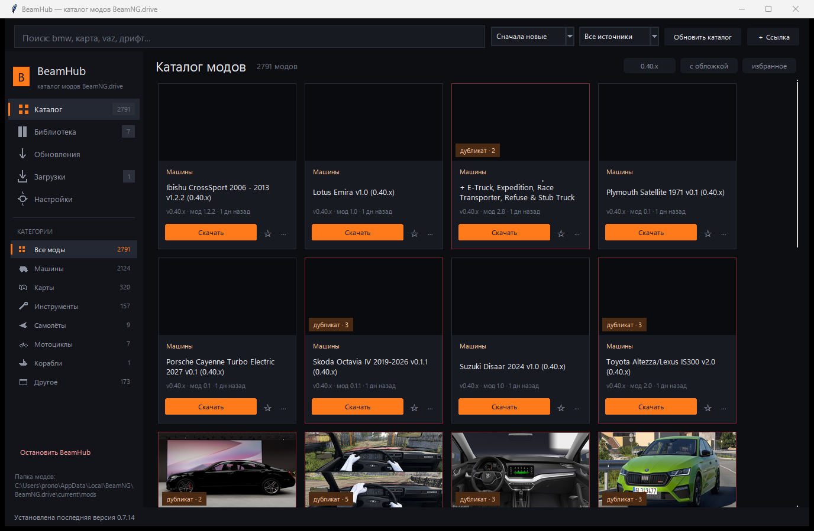
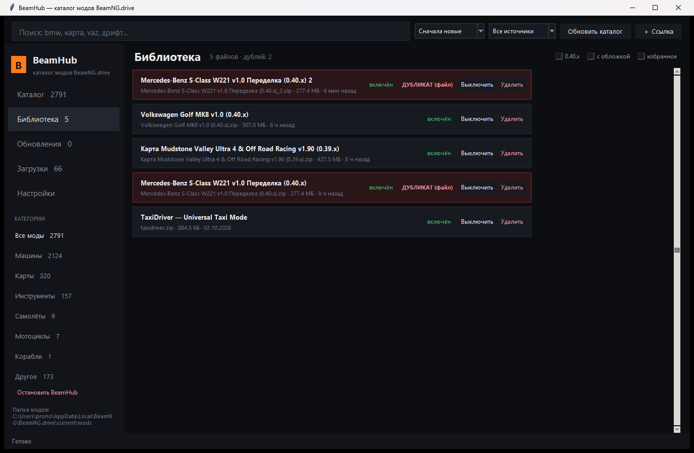
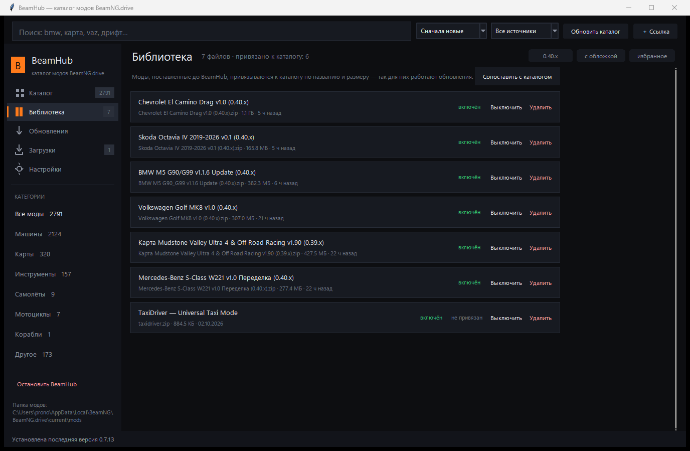
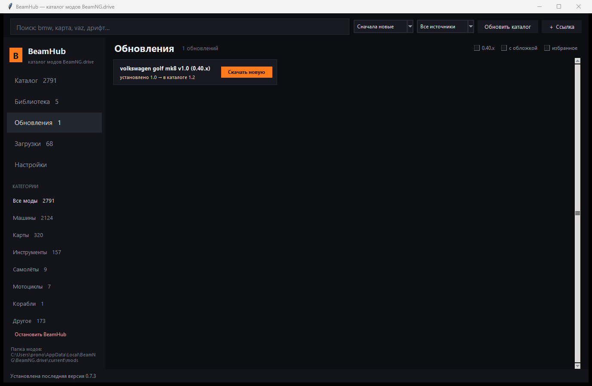
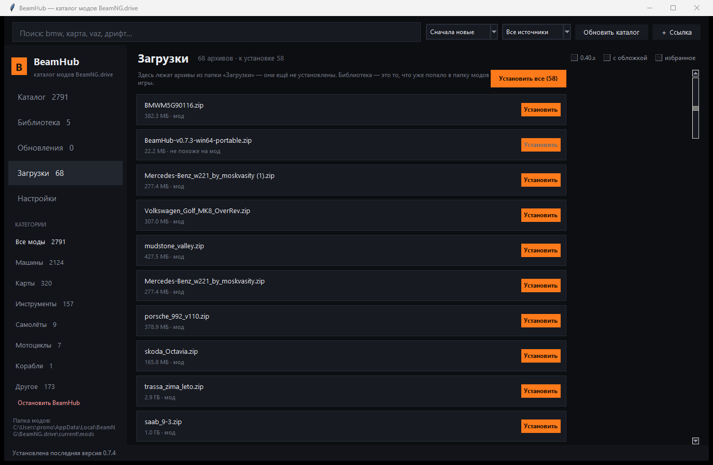
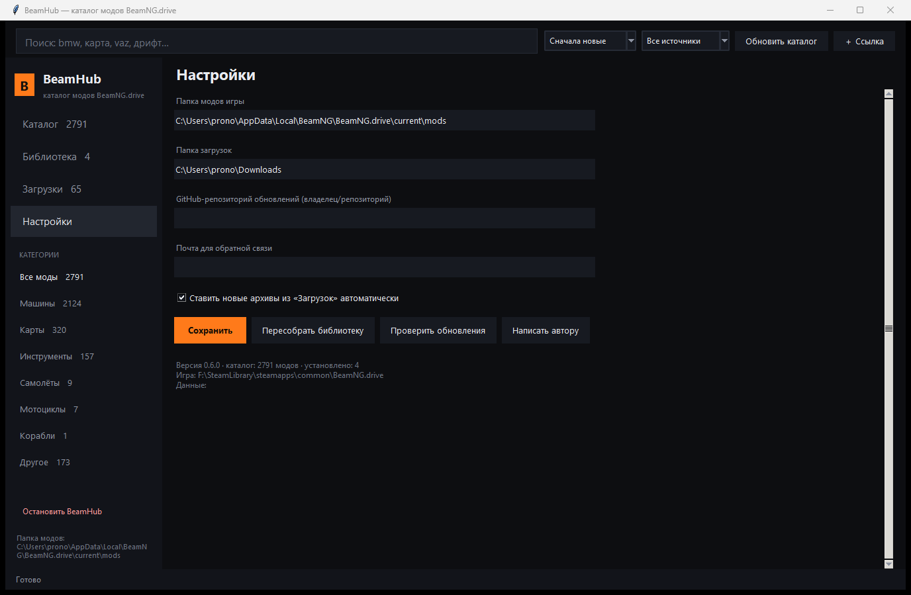

# BeamHub — лаунчер-каталог модов для BeamNG.drive

**Один каталог вместо десяти вкладок с файлообменниками.** Ищешь мод, жмёшь «Установить» — BeamHub сам скачивает архив, проверяет его и кладёт в папку игры.

---

## Возможности

| | |
|---|---|
| **2791 мод с четырёх сайтов** | modsgaming.ru, playground.ru, beamngland.com, beamngmods.net — в одном каталоге |
| **Категории и сортировки** | машины, карты, инструменты, самолёты, мотоциклы; новые, по названию, по размеру, по популярности |
| **Поиск** | по названию, описанию и автору, с фильтрами «0.40.x», «с обложкой», «избранное» |
| **Установка в один клик** | архив скачивается, проверяется и попадает в `mods` игры; дубликаты по хешу не ставятся |
| **Дубликаты** | один и тот же мод с разных сайтов помечается прямо в каталоге, в библиотеке — красной строкой |
| **Уже установленные моды** | библиотека сканирует папку игры и привязывает старые моды к каталогу по названию и размеру — для них тоже работают обновления |
| **Обновление на месте** | новая версия заменяет старый файл, а не добавляет второй |
| **Установить все** | накопились архивы в «Загрузках» — один клик ставит их в игру, копии `(1)` пропускаются |
| **Библиотека** | включить / выключить / удалить, метки «обновление» и «дубликат» |
| **Избранное** | звёздочка на карточке, отдельный фильтр |
| **Обновления модов** | отдельная вкладка: что устарело и на какую версию |
| **Свои ссылки** | кнопка «＋ Ссылка» добавляет мод с любого сайта |
| **Автообновление приложения** | через GitHub Releases, со сверкой `sha256` |

### Скриншоты

| Карточка мода | Дубликаты в библиотеке |
|---|---|
|  |  |

| Библиотека: старые моды привязаны к каталогу | Обновления модов |
|---|---|
|  |  |

## Установка

1. Скачай [последний релиз](https://github.com/Owiom/beamhub/releases/latest) — `BeamHub-vX.Y.Z-win64-portable.zip`.
2. Распакуй архив целиком (папка `_internal` должна лежать рядом с `BeamHub.exe`).
3. Запусти `BeamHub\BeamHub.exe`.

Python и ничего больше ставить не нужно: внутри собранный рантайм.

> SmartScreen может ругнуться на «неизвестного издателя» — это нормально для самосборного exe без платной подписи. «Подробнее» → «Выполнить в любом случае».

## Как это работает

1. Жмёшь **«Установить»** на карточке.
2. Открывается страница мода в браузере — сайты отдают файл только после проверки Cloudflare, обойти её нельзя. Нажимаешь там «Скачать».
3. BeamHub слушает папку загрузок: увидел новый `.zip` — проверил структуру (`levels/`, `vehicles/`, `info.json`), срезал лишнюю обёртку, посчитал хеш и положил в папку игры.
4. В строке состояния — «Установлено: …», мод сразу в библиотеке.

Уже скачанные архивы лежат во вкладке **«Загрузки»** — ставятся одним нажатием.

## Безопасность

Приложение локальное: сервер слушает только `127.0.0.1`, наружу не отдаётся. API защищён от CSRF, DNS rebinding, SSRF и path traversal — подробности в [SECURITY.md](SECURITY.md).

Важно понимать: **мод — это код** (Lua), и BeamHub проверяет структуру архива, но не содержимое. Ставь моды из проверенных источников.

## FAQ

**Где лежат моды и данные?**
Моды — в `%LOCALAPPDATA%\BeamNG\BeamNG.drive\current\mods` (или `Documents\BeamNG.drive\mods` на старых версиях). База и настройки — в `%LOCALAPPDATA%\BeamHub`.

**Почему скачивание открывается в браузере?**
Файлообменники отдают файл только браузеру после рекламной страницы. Дальше BeamHub подхватывает файл сам — кликать в приложении дважды не нужно.

**Работает с версией игры 0.40?**
Да, фильтр «0.40.x» есть в каталоге. Моды помечены версией игры, для которой сделаны.

**Мод поставился, а игры его не видит?**
Перезапусти игру — `mods` читаются при старте. Если не помогло, посмотри, что в архиве есть `levels/` или `vehicles/` в корне: BeamHub это чинит, но некоторые архивы собраны нестандартно.

**В «Загрузках» много файлов, а в библиотеке мало — почему?**
«Загрузки» — это содержимое папки загрузок, архивы, которые ещё не попали в игру. Библиотека — файлы в папке `mods`. Кнопка «Установить все» переносит архивы в игру одним нажатием, копии с одинаковым названием и размером пропускаются.

**Это безопасно?**
Сетевую часть я закрыл и покрыл тестами, но гарантий «точно не взломают» не даёт никто, потому что моды — чужой исполняемый код. Подробнее в [SECURITY.md](SECURITY.md).

**А на Linux / macOS?**
Пока только Windows: интерфейс на tkinter, сборка через PyInstaller. Порт возможен, но не в ближайших планах.

## Дорожная карта

- [x] каталог с четырёх источников, поиск и фильтры
- [x] установка, библиотека, включение/выключение
- [x] дубликаты, избранное, обновления модов
- [x] автообновление приложения
- [ ] коллекции модов под конкретный сервер / сценарий
- [ ] галерея скриншотов в карточке
- [ ] установка обновлений модов без подтверждения

## Участие

Пригодится всё: баг-репорты, идеи, новые источники каталога, код. Читай [CONTRIBUTING.md](CONTRIBUTING.md), открывай [issue](https://github.com/Owiom/beamhub/issues) — шаблоны уже есть.

English version: [README.en.md](README.en.md)

## Дисклеймер

BeamHub — неофициальный проект, не связан с BeamNG GmbH. Все моды принадлежат их авторам; приложение хранит только ссылки на публичные страницы сайтов и качает файлы на тех же условиях, что и браузер. Каталог собирается по sitemap с ограничением частоты запросов и кешированием.

Лицензия — [MIT](LICENSE).
