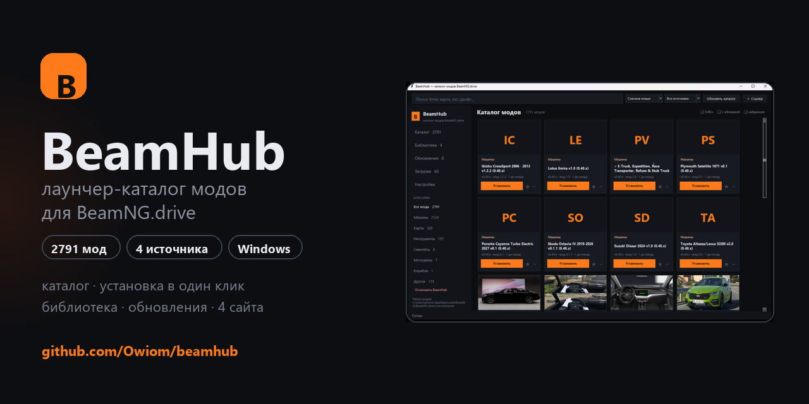

# BeamHub — лаунчер-каталог модов для BeamNG.drive

**Один каталог вместо десяти вкладок с файлообменниками.** Находишь мод, жмёшь «Скачать» — открывается страница мода, архив качает браузер (сайты не отдают файлы скриптам), а BeamHub подхватывает его из «Загрузок», проверяет и кладёт в папку игры. Дальше — библиотека, включение/выключение и проверка обновлений.

[](https://github.com/Owiom/beamhub/releases/latest)
[](https://github.com/Owiom/beamhub/releases)
[](LICENSE)
[](#установка)
[](https://github.com/Owiom/beamhub/commits/main)

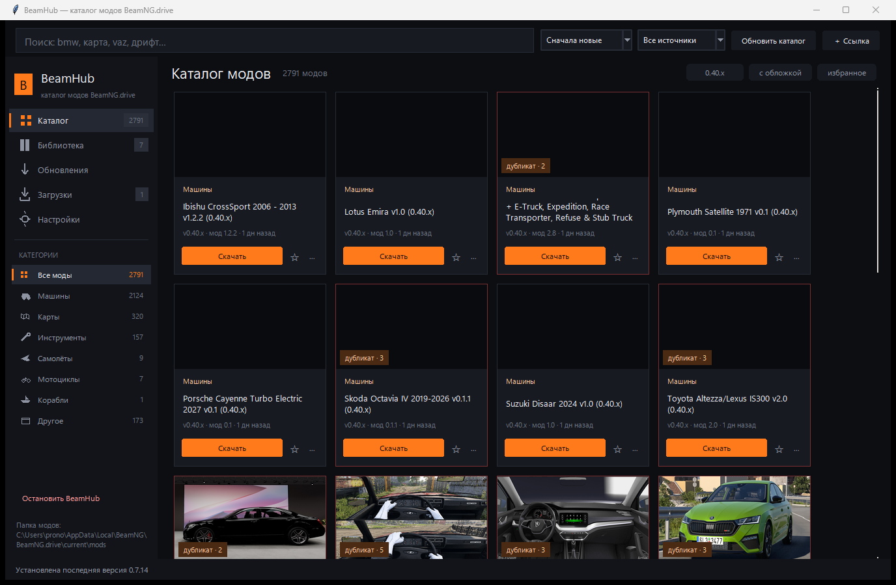

---

## Возможности

| | |
|---|---|
| **2791 мод с четырёх сайтов** | modsgaming.ru, playground.ru, beamngland.com, beamngmods.net — в одном каталоге |
| **Категории и сортировки** | машины, карты, инструменты, самолёты, мотоциклы; новые, по названию, по размеру, по популярности |
| **Поиск** | по названию, описанию и автору, с фильтрами «0.40.x», «с обложкой», «избранное» |
| **Скачал — дальше само** | жмёшь «Скачать», браузер получает архив, BeamHub подхватывает его из «Загрузок», проверяет и кладёт в `mods`; дубликаты по хешу не ставятся |
| **Дубликаты** | один и тот же мод с разных сайтов помечается прямо в каталоге, в библиотеке — красной строкой |
| **Уже установленные моды** | библиотека сканирует папку игры и привязывает старые моды к каталогу по названию и размеру — для них тоже работают обновления |
| **Обновление на месте** | новая версия заменяет старый файл, а не добавляет второй |
| **Установить все** | накопились архивы в «Загрузках» — один клик ставит их в игру, копии `(1)` пропускаются |
| **Русский и English** | кнопка RU/EN в шапке или в настройках — интерфейс переключается на месте, без перезапуска |
| **Сборки сообщества** | подборки модов (drift, offroad, JDM…) с описанием, тегами и историей версий; установка всей сборки одной кнопкой, уже стоящие моды пропускаются |
| **Аккаунты** | профиль с никнеймом и описанием, подписки на авторов, черновики и публикация сборок (вход через Google — на подходе, сейчас локальный) |
| **Библиотека** | включить / выключить / удалить, метки «обновление» и «дубликат» |
| **Избранное** | звёздочка на карточке, отдельный фильтр |
| **Обновления модов** | отдельная вкладка: что устарело и на какую версию |
| **Свои ссылки** | кнопка «＋ Ссылка» добавляет мод с любого сайта |
| **Автообновление приложения** | через GitHub Releases, со сверкой `sha256` |

### Скриншоты

| Карточка мода | Дубликаты в библиотеке |
|---|---|
| 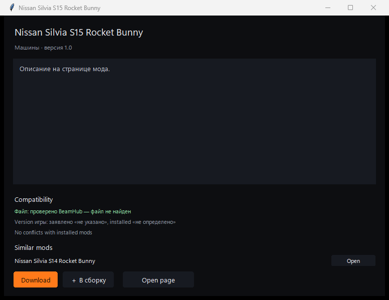 | 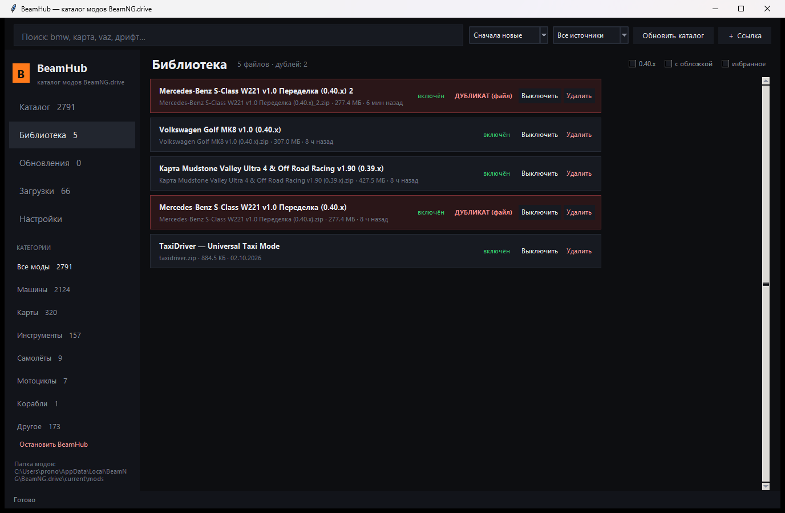 |

| Библиотека: старые моды привязаны к каталогу | Обновления модов |
|---|---|
| 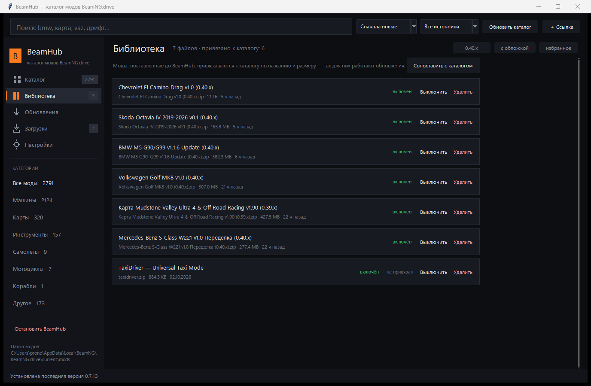 | 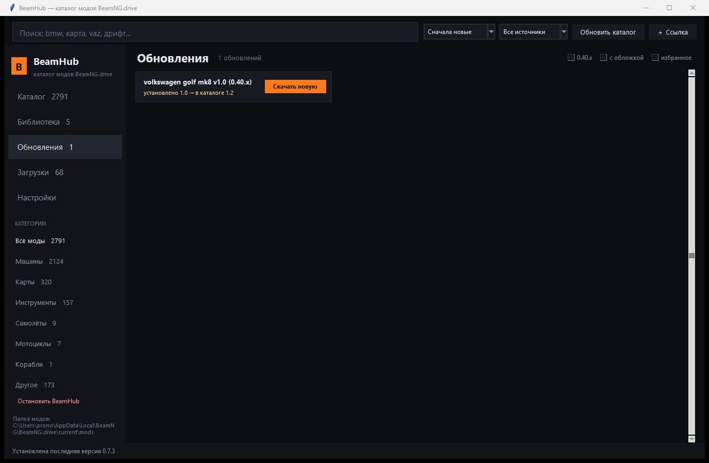 |

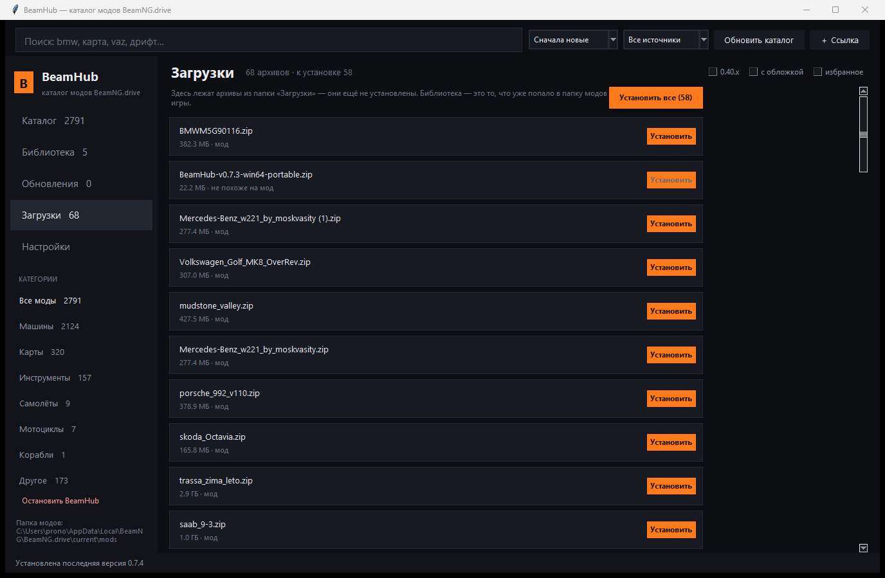

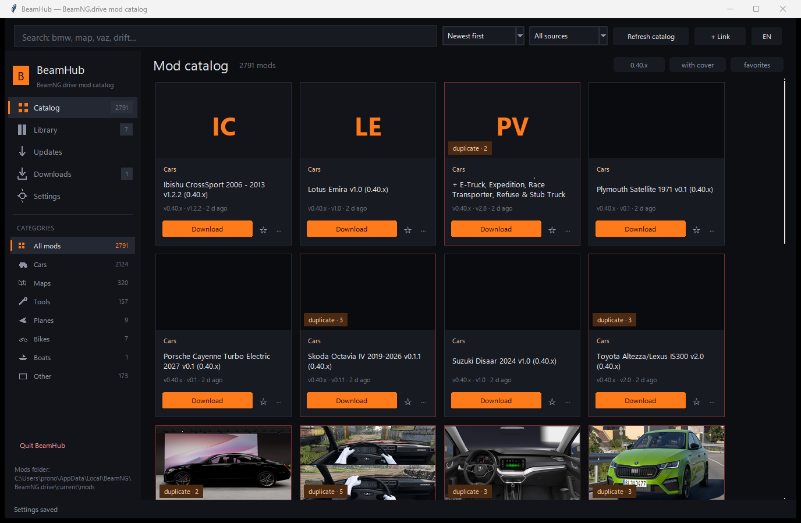

## Сборки сообщества

Сборка — это подборка модов каталога под конкретный стиль: Drift, Offroad, JDM и другие.
Смотреть можно без аккаунта, создавать и публиковать — после входа.

| Список сборок | Карточка сборки |
|---|---|
| 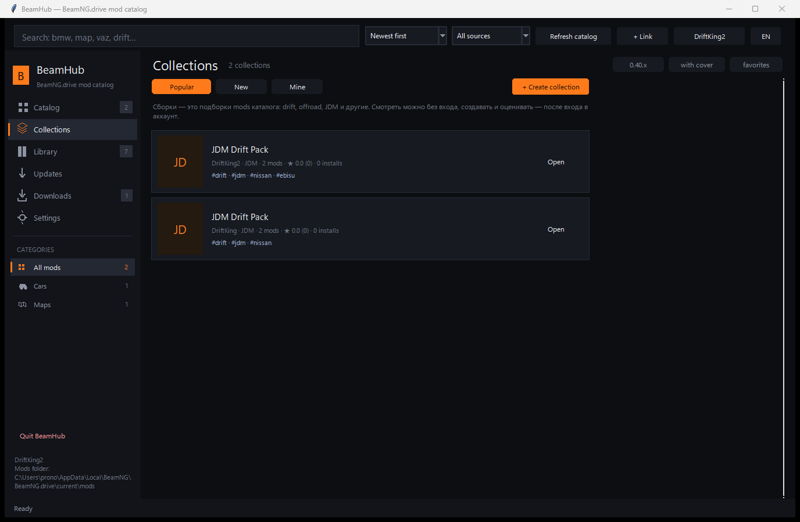 | 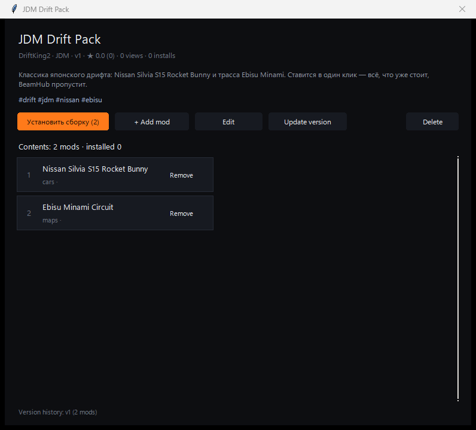 |

Что умеет раздел:

- название, описание, категория, теги и обложка;
- добавление модов прямо из карточки каталога (кнопка «＋ В сборку»);
- черновик и публикация, каждая публикация — новая версия с историей состава;
- **«Установить сборку»** ставит только недостающие моды: уже установленные помечаются
  галочкой и повторно не скачиваются;
- счётчики просмотров и установок раздельные.

Техническое описание платформы и план развития — в [docs/PLATFORM.md](docs/PLATFORM.md).

## Отзывы и комментарии

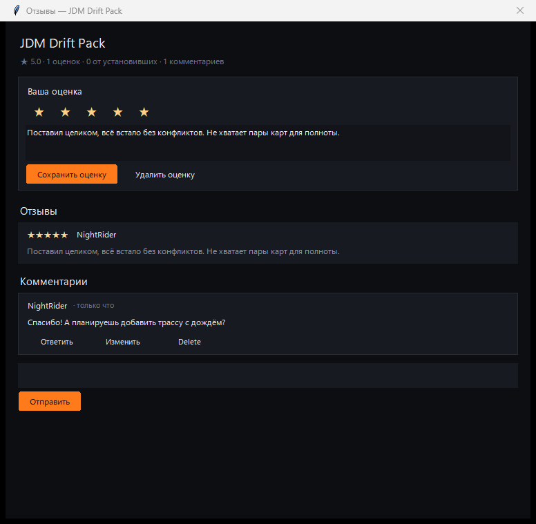

Под каждой сборкой — оценки и обсуждение:

- **1–5 звёзд** и текстовый отзыв; одна оценка на пользователя, повторная заменяет прежнюю;
- **комментарии и ответы** (ответ на ответ прикрепляется к корню ветки, чтобы не было «лестницы»);
- правка и удаление **только своих** сообщений; модератор может удалить чужое — действие попадает в журнал;
- отметка **«✓ установил»** ставится по факту: мод реально стоит в библиотеке BeamHub, а не со слов;
- счётчик лимитов: не больше 12 комментариев за 10 минут и 30 оценок в час с одного аккаунта;
- сводка: средняя оценка, число оценок, сколько отзывов от установивших.

## Облако и аккаунты (Supabase)

Google Cloud не нужен — вход по email и паролю. Пошагово — в [supabase/README.md](supabase/README.md):

1. создать бесплатный проект Supabase и выполнить [`supabase/schema.sql`](supabase/schema.sql);
2. **Authentication → Sign In / Providers → Email** → выключить **Confirm email**;
3. **Project Settings → API** → скопировать **Project URL** и **anon public**;
4. в BeamHub: **Настройки → «Облако (Supabase)»** → вставить URL и anon key → «Сохранить облако»;
5. ввести email и пароль → «Создать аккаунт» (в следующий раз — «Войти по email»).

Вход через Google — необязательное дополнение; его настройка описана в том же файле.

**Ключи уже вшиты в эту сборку.** BeamHub 0.9.4+ подключается к проекту
`gbibqtdjipiqzaarbrpd.supabase.co` автоматически: игроку не нужно ничего вводить.

**Для игроков это одна кнопка.** Владелец вшивает ключи в сборку (`py tools\bake_cloud.py <url> <anon>` перед сборкой), после чего все скачавшие просто нажимают «Войти» и вводят email с паролем — никаких настроек и ключей.

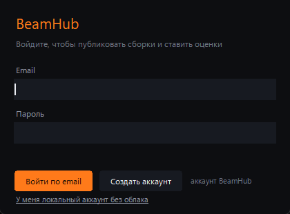


Без облака всё продолжает работать: аккаунты и сборки хранятся локально.
Локальный вход по email/паролю остаётся запасным вариантом.

**Синхронизация**: в настройках кнопки «Мои сборки в облако» и «Загрузить из облака».
Отправляются только опубликованные сборки, повторная отправка обновляет состав, а не плодит копии;
чужие сборки сохраняются локально с пометкой «из облака» и ником автора.
Вместе со сборками уходят и приходят **комментарии и оценки**: id совпадают, поэтому повторная
синхронизация обновляет записи, а не дублирует их.
Модераторы дополнительно получают очередь жалоб и журнал действий из облака, а решение
по жалобе уходит туда же.

Проверка без вашего проекта: `py tools\sync_e2e.py` поднимает фейковый Supabase и настоящее
приложение и проходит весь путь — вход, сборка, отзывы, push, чужая сборка, pull, модерация.

## Модерация

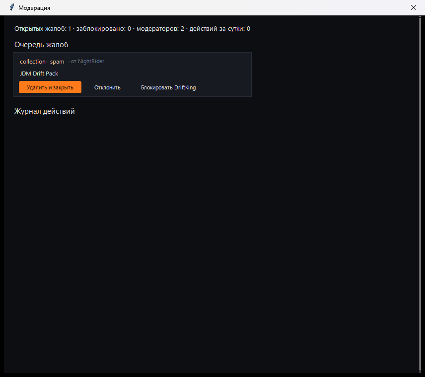

- **жалобы** на сборки, комментарии, моды и пользователей — из карточки сборки («Пожаловаться»);
- **очередь** для модераторов: видно тип, причину, текст объекта и автора; действия —
  «Удалить и закрыть», «Отклонить», «Заблокировать автора»;
- **блокировка** сразу сбрасывает сессии нарушителя и закрывает вход;
- **журнал действий**: кто, что и когда сделал — включая выдачу ролей;
- роли проверяются на сервере: обычный пользователь не увидит очередь и не получит доступ к API.

Выдать роль можно из командной строки:

```bat
py tools\grant_role.py author@example.com moderator
py tools\grant_role.py author@example.com admin
```

## Статистика, рекомендации и совместимость

| Статистика сообщества | Совместимость и похожие моды |
|---|---|
| 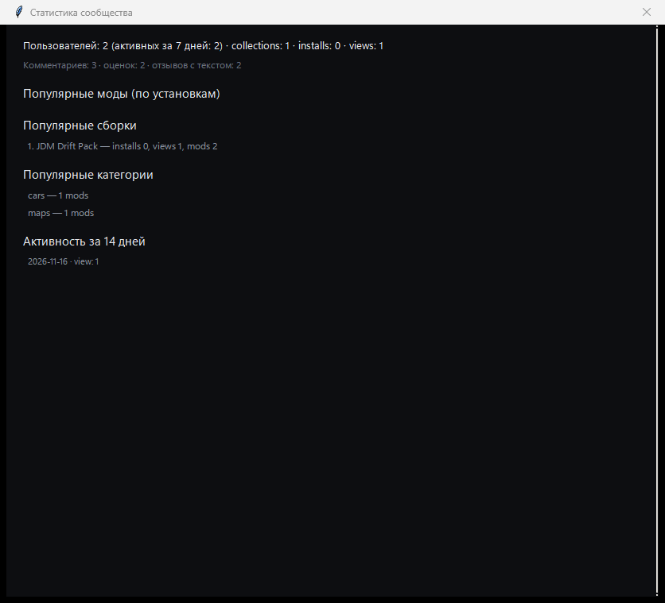 |  |

- **статистика** (Настройки → «Статистика сообщества»): пользователи и активные за 7 дней,
  сборки, установки, просмотры, комментарии, оценки, топ модов и сборок, популярные категории,
  лента активности за 14 дней. Установки, скачивания и просмотры считаются **раздельно**;
- **рекомендации**: вкладка «Рекомендуемые» у сборок (рейтинг × число оценок + установки),
  «Похожие моды» в карточке мода (категория, слова названия, автор) и подбор по категориям
  из вашей библиотеки; без аккаунта — популярное. Всё на своих алгоритмах, без платных API;
- **совместимость** в карточке мода: доступность файла (реальный запрос к ссылке, кеш 6 часов),
  версия игры — «заявлено автором», конфликты с уже установленными модами.
  BeamHub пишет «проверено», только когда действительно сходил по ссылке; иначе — «неизвестно».


## Установка

1. Скачай [последний релиз](https://github.com/Owiom/beamhub/releases/latest) — `BeamHub-vX.Y.Z-win64-portable.zip`.
2. Распакуй архив целиком (папка `_internal` должна лежать рядом с `BeamHub.exe`).
3. Запусти `BeamHub\BeamHub.exe`.

Python и ничего больше ставить не нужно: внутри собранный рантайм.

> SmartScreen может ругнуться на «неизвестного издателя» — это нормально для самосборного exe без платной подписи. «Подробнее» → «Выполнить в любом случае».

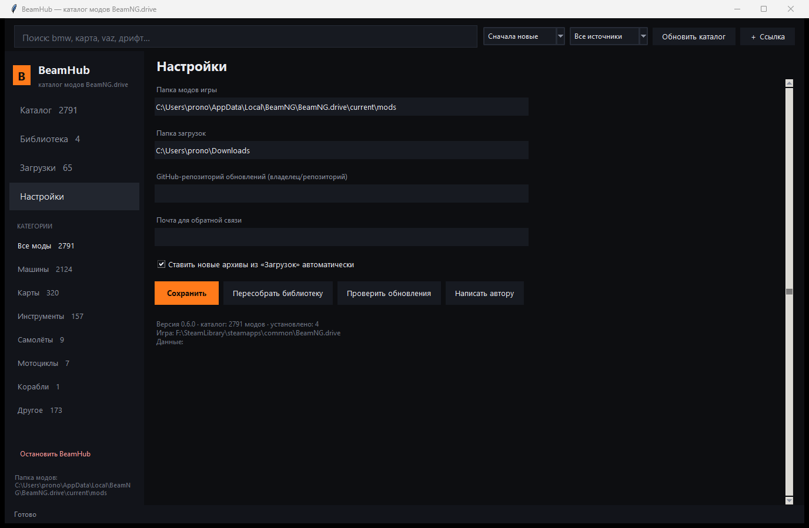

## Как это работает

1. Жмёшь **«Скачать»** на карточке — открывается страница мода в браузере.
2. Открывается страница мода в браузере — сайты отдают файл только после проверки Cloudflare, обойти её нельзя. Нажимаешь там «Скачать».
3. BeamHub слушает папку загрузок: увидел новый `.zip` — проверил структуру (`levels/`, `vehicles/`, `info.json`), срезал лишнюю обёртку, посчитал хеш и положил в папку игры.
4. В строке состояния — «Установлено: …», мод сразу в библиотеке.

Уже скачанные архивы лежат во вкладке **«Загрузки»** — ставятся одним нажатием.

## Безопасность

Приложение локальное: сервер слушает только `127.0.0.1`, наружу не отдаётся. API защищён от CSRF, DNS rebinding, SSRF и path traversal — подробности в [SECURITY.md](SECURITY.md).

Важно понимать: **мод — это код** (Lua), и BeamHub проверяет структуру архива, но не содержимое. Ставь моды из проверенных источников.

## FAQ

**Где лежат моды и данные?**
Моды — в `%LOCALAPPDATA%\BeamNG\BeamNG.drive\current\mods` (или `Documents\BeamNG.drive\mods` на старых версиях). База и настройки — в `%LOCALAPPDATA%\BeamHub`.

**Почему скачивание открывается в браузере?**
Файлообменники отдают файл только браузеру после рекламной страницы. Дальше BeamHub подхватывает файл сам — кликать в приложении дважды не нужно.

**Работает с версией игры 0.40?**
Да, фильтр «0.40.x» есть в каталоге. Моды помечены версией игры, для которой сделаны.

**Мод поставился, а игры его не видит?**
Перезапусти игру — `mods` читаются при старте. Если не помогло, посмотри, что в архиве есть `levels/` или `vehicles/` в корне: BeamHub это чинит, но некоторые архивы собраны нестандартно.

**В «Загрузках» много файлов, а в библиотеке мало — почему?**
«Загрузки» — это содержимое папки загрузок, архивы, которые ещё не попали в игру. Библиотека — файлы в папке `mods`. Кнопка «Установить все» переносит архивы в игру одним нажатием, копии с одинаковым названием и размером пропускаются.

**Игра пишет «mod vanished», а в библиотеке мода нет — что это?**
Так BeamNG сообщает, что помнит мод, но файла нет в папке `mods` (файл удалили или перенесли). BeamHub показывает только реально существующие файлы. Если архив сохранился в «Загрузках» — поставьте его снова, кнопкой «Установить все» или по одному; после установки мод вернётся в игру и появится в библиотеке.

**Это безопасно?**
Сетевую часть я закрыл и покрыл тестами, но гарантий «точно не взломают» не даёт никто, потому что моды — чужой исполняемый код. Подробнее в [SECURITY.md](SECURITY.md).

**А на Linux / macOS?**
Пока только Windows: интерфейс на tkinter, сборка через PyInstaller. Порт возможен, но не в ближайших планах.

## Дорожная карта

- [x] каталог с четырёх источников, поиск и фильтры
- [x] установка, библиотека, включение/выключение
- [x] дубликаты, избранное, обновления модов
- [x] автообновление приложения
- [ ] коллекции модов под конкретный сервер / сценарий
- [ ] галерея скриншотов в карточке
- [ ] установка обновлений модов без подтверждения

## Обратная связь

Настройки → **«Обратная связь»**: пишешь, что случилось, а приложение само добавляет
версию, систему, число модов и хвост лога. Дальше одна кнопка — **«Открыть GitHub»**:
открывается issue с готовым текстом, остаётся нажать «Submit new issue».

Перед отправкой текст видно целиком: путь к игре по умолчанию не добавляется,
хвост лога можно снять галочкой. Если аккаунта нет — рядом кнопка «Скопировать текст».

## Участие

Пригодится всё: баг-репорты, идеи, новые источники каталога, код. Читай [CONTRIBUTING.md](CONTRIBUTING.md), открывай [issue](https://github.com/Owiom/beamhub/issues) — шаблоны уже есть.

English version: [README.en.md](README.en.md)

## Дисклеймер

BeamHub — неофициальный проект, не связан с BeamNG GmbH. Все моды принадлежат их авторам; приложение хранит только ссылки на публичные страницы сайтов и качает файлы на тех же условиях, что и браузер. Каталог собирается по sitemap с ограничением частоты запросов и кешированием.

Лицензия — [MIT](LICENSE).
