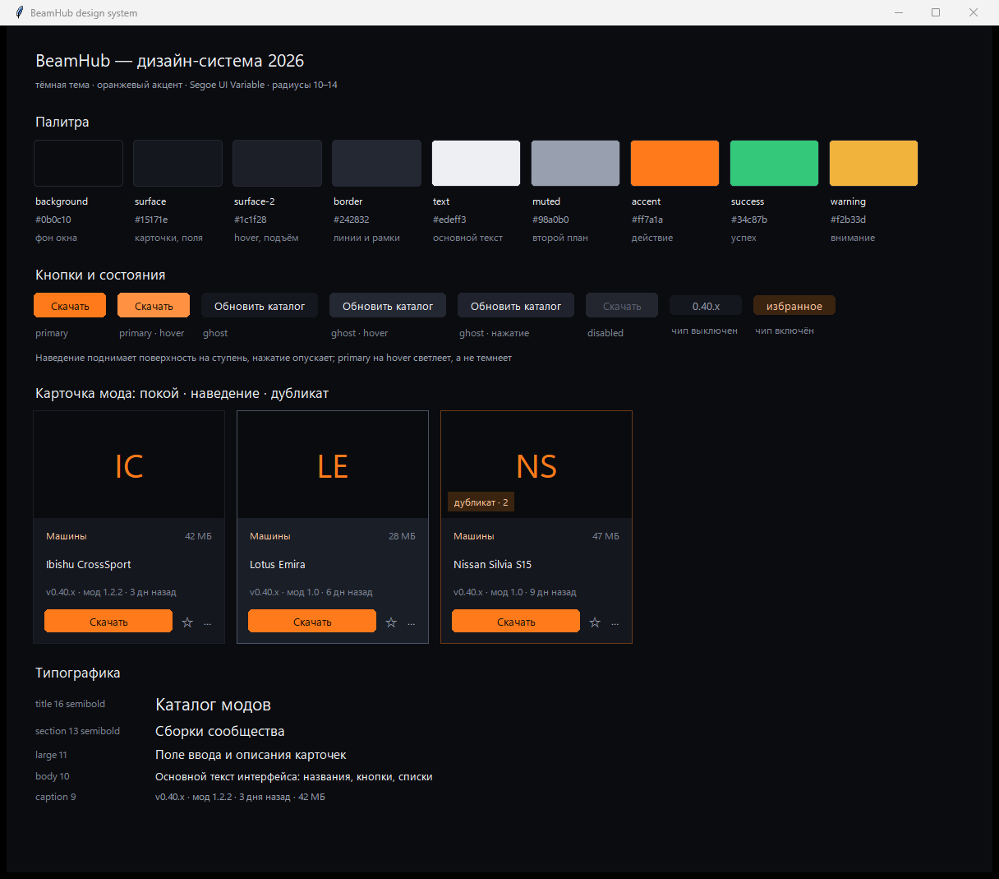

# BeamHub — дизайн-система 2026

Документ описывает визуальный язык приложения (окно на tkinter) и то, как он
применяется. Обновлён 17.11.2026. Токены уже живут в `core/theme.py`; часть
констант интерфейса (`core/tkui.py`) переносит ведущий агент по таблицам ниже.



## 1. Принципы

1. **Тёмная база, светлые поверхности.** Фон окна почти чёрный, а всё, с чем
   работают (карточки, панели, поля), светлее фона на одну-две ступени. Глаз
   находит контент по яркости, а не по рамкам.
2. **Оранжевый — это действие, а не украшение.** `#ff7a1a` достаётся одному
   элементу на экран: главной кнопке («Скачать») и активному чипу. Всё
   остальное — нейтральные поверхности.
3. **Рамки почти не видны.** Жёсткая сетка `#262b36` вокруг каждой карточки
   ушла: в покое рамка на полтона светлее поверхности, при наведении
   проявляется, но не «загорается».
4. **Состояния читаются без цвета.** hover — светлее на ступень, нажатие —
   темнее на полступени, disabled — приглушённый текст без акцента.
5. **Одна шкала на всё.** Радиусы 10–14, отступы 8/12/16/24, пять размеров
   шрифта. Никаких «на глаз» 7 и 17 пикселей.

## 2. Палитра

Контраст указан к поверхности, на которой цвет чаще всего лежит
(`surface` для текста, `background` для рамок и подложек).

| Токен | HEX | Роль | Контраст |
|---|---|---|---|
| `background` | `#0b0c10` | фон окна, «воздух» между блоками | — |
| `surface` | `#15171e` | карточки, панели, поля ввода, тулбар | — |
| `surface-2` | `#1c1f28` | hover, приподнятые блоки, вложенные панели | — |
| `surface-3` | `#242833` | нажатие, выбранная строка списка | — |
| `border` | `#242832` | единственная линия сетки: разделители, рамки полей | 1.2:1 к surface |
| `border-soft` | `#1b1e26` | рамка карточки в покое (почти невидима) | 1.1:1 |
| `border-strong` | `#4a5364` | рамка при наведении, фокус | 2.3:1 |
| `text` | `#edeff3` | заголовки, названия, кнопки | 15.5:1 |
| `muted` | `#98a0b0` | второй план: подписи навигации, неактивные чипы | 6.8:1 |
| `dim` | `#7d8494` | метаданные карточки, счётчики, статус-бар | 4.8:1 |
| `accent` | `#ff7a1a` | главное действие, активный чип, полоска выбранного пункта | 7.4:1 к bg |
| `accent-hover` | `#ff9142` | наведение на главную кнопку | — |
| `accent-press` | `#e86a0f` | нажатие главной кнопки | — |
| `accent-soft` | `#3a2410` | подложка бейджа «дубликат», включённый чип | — |
| `accent-soft-text` | `#ffc79b` | текст на `accent-soft`, категория мода | 9.6:1 |
| `on-accent` | `#1a0f04` | текст на оранжевом | 7.2:1 |
| `success` | `#34c87b` | «установлен», активный мод, успешный синк | 8.2:1 к surface |
| `warning` | `#f2b33d` | «есть обновление», предупреждения модерации | 9.6:1 |
| `danger` | `#f05252` | удаление, жалоба, ошибка | — |

Правила:

- оранжевым **не** пишем обычный текст — только заливку кнопки и мелкий акцент;
- `dim` — максимум для метаданных; если текст важен (ошибка, версия, статус),
  берём `muted` или `text`;
- цветные подложки (`accent-soft`, `danger` с прозрачностью-эрзацем) — только
  для бейджей; целые карточки не тонируем, кроме «дубликата» (тонкая тёплая
  рамка).

## 3. Как перенести в `core/tkui.py`

Константы в начале файла заменяются один раз и дальше используются как есть.
Смысл имён сохранён, поэтому остальной код трогать не нужно.

| Константа | Было | Стало |
|---|---|---|
| `BG` | `#0d0e11` | `#0b0c10` |
| `SOFT` (сайдбар, статус-бар) | `#12141a` | `#101218` |
| `PANEL` | `#171a21` | `#15171e` |
| `LINE` | `#262b36` | `#242832` |
| — (новая) `LINE_SOFT` | — | `#1b1e26` |
| `TEXT` | `#e9ebf0` | `#edeff3` |
| `MUTED` | `#8d93a1` | `#98a0b0` |
| `DIM` | `#6b7280` | `#7d8494` |
| `ACCENT` | `#ff7a1a` | `#ff7a1a` (без изменений) |
| — (новая) `ACCENT_SOFT` | — | `#3a2410` |
| — (новая) `ACCENT_SOFT_TEXT` | — | `#ffc79b` |
| `GREEN` | `#35c46b` | `#34c87b` |
| — (новая) `WARN` | — | `#f2b33d` |
| — (новая) `DANGER` | — | `#f05252` |
| `HOVER_BG` | `#1b1f28` | `#1c1f28` |
| `ACTIVE_BG` | `#232833` | `#242833` |
| `DUP_BG` | `#2a1618` | `#241317` |
| `DUP_LINE` | `#7a2f33` | `#6b3a18` |

Замены по месту (имена функций — из текущего `core/tkui.py`):

- `_card()`: фон `PANEL`, рамка `LINE` → `theme.CARD["bg"]` и
  `theme.card_colors(False, duplicate)[1]`. Толщину `highlightthickness=1`
  оставляем: у `tk.Frame` в tkinter скруглений нет, и мягкая линия — лучший
  компромисс.
- `_bind_card_hover()`: `"#55617a"` → `theme.card_colors(True, duplicate)[1]`,
  возврат в `theme.card_colors(False, duplicate)[1]`. Больше ничего не меняем:
  внутренние `tk.Frame` непрозрачны, поэтому подсвечиваем только рамку.
- `_paint_chips()`: включённый чип — `ACCENT_SOFT` / `ACCENT_SOFT_TEXT`, hover
  `#4a2e14`; выключенный — `PANEL` / `MUTED`, hover `SURFACE_3`.
- `_styles()` (ttk): `fieldbackground=PANEL`, `bordercolor=LINE_SOFT`,
  `arrowcolor=MUTED`; скроллбар `background="#242833"`,
  `active="#4a5364"`, `troughcolor=BG`, `width=10` → `12`.
- Поле поиска: `highlightbackground=LINE_SOFT`; по `FocusIn` —
  `highlightbackground=BORDER_STRONG`, по `FocusOut` — обратно.
- Строки списков (библиотека, загрузки, настройки): фон `PANEL`, hover
  `SURFACE_2`, выбранная — `SURFACE_3`; «дубликат» — `DUP_BG` с рамкой
  `DUP_LINE`.
- Полоска выбранного пункта в сайдбаре: `ACCENT`, ширина 3, скругление 2;
  подложка — `ACTIVE_BG`, наведение — `HOVER_BG`.

## 4. Радиусы

| Токен | Значение | Где |
|---|---|---|
| `RADIUS_XS` | 8 | бейджи и плашки внутри карточки (не для `RoundButton`) |
| `RADIUS_SM` | 10 | кнопки тулбара, строки списков, поля ввода |
| `RADIUS` | 12 | кнопки по умолчанию, диалоги, панели |
| `RADIUS_LG` | 14 | чипы-«таблетки», крупные кнопки |

`theme.RoundButton` держит радиус в коридоре 10–14 и никогда не даёт больше
половины высоты, поэтому старые вызовы `radius=8` автоматически становятся 10
и интерфейс не разъезжается. Больше 14 в 2026 не нужно: скругление
перестаёт читаться как форма и начинает выглядеть «пузырём».

## 5. Отступы и сетка

Шкала: **8 / 12 / 16 / 24** (плюс 4 внутри плотных строк).

| Отступ | Где |
|---|---|
| 4 | между иконкой и текстом, между звёздочкой и «⋯» |
| 8 | внутри кнопки по вертикали, между чипами, между строками списка |
| 12 | внутренние поля карточки, зазор между карточками в сетке |
| 16 | между блоками внутри панели, между тулбаром и контентом |
| 24 | внешние поля страницы (было 16–18) |

Сетка каталога: карточка 232×~330, зазор 12, четыре колонки при ширине окна
≥ 1100. Внутренние поля карточки — 12 по горизонтали, 10–12 по вертикали.

## 6. Типографика

Шрифт: **Segoe UI Variable Text** (Windows 11), откат — Segoe UI → Tahoma.
Заголовки — `Segoe UI Variable Display` там, где он есть. Полужирный — этот же
шрифт с весом 600 (`Segoe UI Semibold` на Windows 10).

| Роль | Размер | Вес | Где |
|---|---|---|---|
| `title` | 16 | semibold | заголовок экрана («Каталог модов») |
| `section` | 13 | semibold | заголовки страниц, секций настроек |
| `large` | 11 | regular | поле поиска, описания |
| `body` | 10 | regular | названия, кнопки, пункты меню |
| `caption` | 9 | regular | метаданные, счётчики, статус-бар |

В `tkui.py` это значит: 17 → 16, 14 → 13, 8 → 9, остальное остаётся
(10, 11). Девятка вместо восьмёрки — главное улучшение читаемости: на
2560×1440 восьмёрка превращается в серую пыль.

Хелперы: `theme.font_setup()` возвращает пару шрифтов,
`theme.ui_font(theme.TYPE["body"])` — кортеж для `tk.Label`, `theme.TYPE` —
сама шкала.

## 7. Состояния

| Элемент | Покой | Hover | Нажатие | Disabled |
|---|---|---|---|---|
| Кнопка `primary` | `accent` + `on-accent` | `accent-hover` (светлее) | `accent-press` (темнее) | `#23262e` + `#5a6172` |
| Кнопка `ghost` | `#171a21` + `text` | `surface-3` | на 12 % темнее hover | `#16181f` + `#5a6172` |
| Чип выключен | `surface` + `muted` | `surface-3` + `text` | темнее на 12 % | — |
| Чип включён | `accent-soft` + `accent-soft-text` | `#4a2e14` | темнее на 12 % | — |
| Карточка | `surface` + `border-soft` | `border-strong` | — | — |
| Карточка-дубликат | `surface` + `#6b3a18` | `#8a4a1c` | — | — |
| Строка списка | `surface` | `surface-2` | `surface-3` | `dim` |

Кнопка «primary» на hover **светлеет**, а не темнеет: на тёмной теме это
читается как подсветка, а не как провал. Нажатие уже темнее — так палец/мышь
получает «отдачу».

## 8. Карточка мода: мягкая подсветка вместо рамки

Сейчас карточка обведена `#262b36` — это самая заметная линия в интерфейсе, и
она спорит с обложкой. В новой системе:

```python
bg, border = theme.card_colors(hover=False, duplicate=item.get("duplicate"))
card = tk.Frame(parent, bg=bg, highlightthickness=1, highlightbackground=border)
```

```python
def _bind_card_hover(self, card: tk.Frame, duplicate: bool) -> None:
    normal = theme.card_colors(False, duplicate)[1]
    hover = theme.card_colors(True, duplicate)[1]

    def enter(_event=None) -> None:
        card.configure(highlightbackground=hover)

    def leave(_event=None) -> None:
        card.after(30, lambda: None if inside() else card.configure(
            highlightbackground=normal))
```

Что это даёт: в покое карточка отделяется от фона собственной поверхностью
(`#15171e` против `#0b0c10`), а рамка `#1b1e26` только поддерживает край. При
наведении проявляется `#39404e` — заметно, но без «вспышки». Тёплая рамка
дубликата (`#6b3a18`) остаётся единственным цветным сигналом.

Внутри карточки: категория — `accent-soft-text`, размер и метаданные — `dim`,
название — `body` semibold `text` (2 строки), «Скачать» — единственная
primary-кнопка, звёздочка и «⋯» — приглушённые `muted`.

## 9. Что уже применено

`core/theme.py` переписан на токены; `core/tkui.py` не тронут.

- `PALETTE`, плоские псевдонимы `BG/SURFACE/SURFACE_2/SURFACE_3/BORDER/TEXT/
  MUTED/DIM/ACCENT/SUCCESS/WARNING`;
- `RADIUS_SM=10`, `RADIUS=12`, `RADIUS_LG=14`, `RADIUS_XS=8`;
- `SPACE = {"xs": 4, "sm": 8, "md": 12, "lg": 16, "xl": 24}`;
- `TYPE = {caption: 9, body: 10, large: 11, section: 13, title: 16}`,
  `ui_font()`;
- `BUTTONS` — палитры `primary`/`ghost` со всеми состояниями;
- `CARD`, `card_colors(hover, duplicate)`, `mix(color, other, amount)`;
- `RoundButton`: радиус по умолчанию 12 с коридором 10–14, новые параметры
  `press`, `border`, `border_hover`; `accent_press` берётся из палитры, а если
  передан свой `accent` — вычисляется из него;
- `dark_titlebar()` дополнительно красит заголовок и кромку окна в цвет фона
  (`DWMWA_CAPTION_COLOR`/`DWMWA_BORDER_COLOR`).

Совместимость: `RoundButton(text=…, bg=…, fg=…, hover=…, radius=…, variant=…)`,
`configure(text/state/command)`, `set_palette(bg, fg, hover)` работают как
раньше — старые вызовы в `tkui.py` менять не обязательно.

## 10. Чек-лист для `core/tkui.py`

1. Заменить константы по таблице из раздела 3 (одна правка в начале файла).
2. `_styles()`: цвета combobox и скроллбара.
3. `_build()`: внешние отступы 16 → 24, поле поиска на `LINE_SOFT`,
   фокус — `BORDER_STRONG`.
4. `_card()` + `_bind_card_hover()`: `theme.CARD` и `theme.card_colors()`.
5. `_render_cards()`: `padx/pady` 7 → 12; при необходимости `CARD_W` 232 → 240.
6. `_paint_chips()`: палитры из `BUTTONS`/`ACCENT_SOFT`.
7. Шрифты: 17 → 16, 14 → 13, 8 → 9 (раздел 6).
8. Проверить, что в кадре одна primary-кнопка (карточка → страница мода),
   остальные — ghost.

## 11. Как это проверялось

| Файл | Что на нём |
|---|---|
| `docs/design-before.png` | окно до правок: рамки `#262b36`, радиусы 8, фон `#0d0e11` |
| `docs/design-after.png` | то же окно после `core/theme.py`: радиусы 10–12, чипы-«таблетки» |
| `docs/design-system.png` | лист системы: палитра, состояния кнопок, три состояния карточки, шкала шрифтов |

Метод: приложение запускалось с временной базой
(`BEAMHUB_DB=%TEMP%\beamhub-design\beamhub.db`, `BEAMHUB_DATA` там же,
порт 9110+), в каталог подложены 12 демо-модов, окно снималось
`tools\shot.ps1 -ProcessId <pid> -Out <png>`. Лист дизайн-системы рисуется тем
же `core/theme.py` и снимается так же.

Честно о результатах:

- скриншоты «до/после» отличаются только тем, что реально живёт в
  `theme.py` — радиусы и состояния кнопок. Палитра, карточки, типографика и
  отступы находятся в `tkui.py`, поэтому на «после» их ещё нет: их даст
  правка по разделу 10;
- `dark_titlebar()` в этой сессии не перекрасил заголовок окна: DWM-атрибуты
  заголовка/кромки применились без ошибки, но PrintWindow снял стандартную
  светлую полосу Windows. На Windows 11 22H2+ ожидается тёмный заголовок;
  если его не будет — виноват не `theme.py`, а сборка/тема системы (лечится
  тёмной темой Windows);
- тема приложения не меняет оформление веб-версии (`web/`) — там своя палитра
  в `web/static/styles.css`, и её стоит привести к этим токенам отдельной
  задачей.
