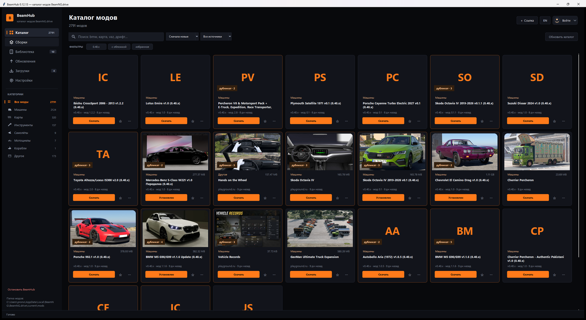

# BeamHub — интерфейс 2026

Документ описывает визуальный язык окна BeamHub (tkinter) и то, что реально
применено в коде. Обновлён 19.11.2026, версия приложения 0.12.13.

Раньше здесь лежал план «как перенести токены в `core/tkui.py`»: дизайн-система
жила только в `core/theme.py`, а окно оставалось прежним. Теперь правки
применены к обоим файлам — шапка, сайдбар, карточки, типографика и пустые
состояния перерисованы, логика не менялась.



## 1. Что изменилось

| Область | Было | Стало |
|---|---|---|
| Шапка | одна строка: поиск, комбобоксы, кнопки; заголовок сбоку | три уровня: титул 22 px + подпись, поиск 40 px с иконкой, ряд чипов; аккаунт — аватар-кружок |
| Сайдбар | строки-прямоугольники, иконки 12 px, отступ 6 | скруглённая плашка активного пункта с акцентной полоской, отступ 12, иконки 19 px |
| Карточка | обложка произвольного кадра, рамка-обводка, кнопки вразнобой | 16:9 со скруглением сверху, единая высота, заголовок ровно 2 строки, кнопка + две квадратные иконки |
| Типографика | 8/9/10/11/12/14/15/16/20/22 | только 9/10/11/13/18/22; реальный полужирный вес |
| Пустые состояния | серая строка текста | иконка на мягкой плашке, заголовок 18 px, подсказка |

Скриншоты:

| Файл | Что на нём |
|---|---|
| `design-before.png` | окно до правок: поиск в общей полосе, плоский сайдбар, рамки карточек |
| `design-after.png` | каталог после правок: шапка, чипы, аватар, карточки 16:9 |
| `catalog-empty-2026.png` | состояние «Ничего не найдено» после поиска `zzzzz` |
| `card-hover-2026.png` | ховер карточки: рамка светлеет до `#4b5670` |

## 2. Принципы

1. **Тёмная база, светлые поверхности.** Фон окна `#08090c`, рабочие
   поверхности на две ступени светлее. Контент находится по яркости, а не по
   сетке рамок.
2. **Оранжевый — действие.** `#ff7a1a` — главная кнопка карточки и активный
   пункт сайдбара. В покое больше нигде не заливается.
3. **Одна шкала.** Радиусы 10–14 (крупные панели 16), отступы 8/12/16/24,
   шесть размеров шрифта. Никаких «на глаз».
4. **Состояния читаются.** hover поднимает поверхность на ступень и проявляет
   рамку, нажатие опускает на полступени, disabled убирает акцент.
5. **Текст важнее декора.** Верхняя строка карточки — название (2 строки,
   полужирный), ниже метаданные. Никаких цветных плашек поверх обложки, кроме
   бейджа «дубликат».

## 3. Палитра

Значения — из `core/theme.py` (`PALETTE`) и продублированы константами в
`core/tkui.py`, чтобы существующий код не пришлось переписывать.

| Токен | HEX | Роль |
|---|---|---|
| `bg` | `#08090c` | фон окна, «воздух» |
| `surface` | `#12141b` | карточки, панели, поля |
| `surface_2` | `#171a22` | hover, поиск, чипы в покое |
| `surface_3` | `#20242f` | нажатие, активный пункт меню |
| `border` | `#232734` | линии полей и разделителей |
| `border_soft` | `#1a1e27` | рамка карточки в покое |
| `border_strong` | `#4b5670` | рамка при наведении, фокус |
| `text` | `#f0f2f7` | основной текст |
| `muted` | `#9aa3b4` | второй план |
| `dim` | `#7a8291` | метаданные, подписи |
| `accent` | `#ff7a1a` | главное действие, активный пункт |
| `accent_hover` | `#ff8f3d` | наведение главной кнопки |
| `accent_press` | `#e96a0b` | нажатие главной кнопки |
| `accent_soft` | `#33200f` | подложка включённого чипа, бейдж |
| `accent_soft_text` | `#ffc08a` | текст на `accent_soft` |
| `on_accent` | `#170d04` | текст на оранжевом |
| `success` | `#34c87b` | «установлен», успех |
| `warning` | `#f2b33d` | предупреждения |
| `danger` | `#f05252` | удаление, ошибка |

Контраст `muted` на `surface` — около 7.4:1, `dim` — около 5.2:1: подписи
читаются на 100 % масштабе и не превращаются в пыль на 2560×1440.

## 4. Типографика

Шрифт: `Segoe UI Variable Text` (Windows 11), откат — `Segoe UI` → `Tahoma`.
`theme.font_setup()` вызывается в `App.__init__` до сборки окна.

| Роль | Размер | Вес | Где |
|---|---|---|---|
| `display` | 22 | bold | заголовок экрана («Каталог модов») |
| `title` | 18 | bold | заголовок страницы мода, пустое состояние |
| `section` | 13 | bold | бренд в сайдбаре, крупные подписи |
| `large` | 11 | normal | поиск, подпись под заголовком |
| `body` | 10 | normal/bold | названия, кнопки, пункты меню |
| `caption` | 9 | normal | метаданные, бейджи, статус-бар |

Полужирный — это тот же Segoe UI Variable с весом `bold`, а не отдельное
семейство `Segoe UI Semibold`: на Windows 11 последнее выглядит как шрифт из
прошлого десятилетия. В `tkui.py` все `font=(FONT_BOLD, N)` заменены на
`font=(FONT_BOLD, N, "bold")`, поэтому заголовки действительно жирные.
`theme.ui_font(size, semibold=True)` возвращает такой же трёхэлементный кортеж.

В файле больше нет размеров 8, 12, 14, 15, 16, 20: проверка
`grep 'font=...FONT..., [0-9]'` даёт только 9/10/11/13/18/22.

## 5. Шапка

Высота шапки — 166 px при трёх рядах; на вкладках, отличных от каталога, ряды
поиска и фильтров скрываются (`_sync_header_tools`), остаётся титул с подписью
и кнопки справа.

```
[ Каталог модов            (22 bold) ]        [＋ Ссылка] [EN] [(аватар) Войти ⌄]
[ 2791 модов              (11 muted) ]

[ 🔍 Поиск: bmw, карта...  (40 px) ] [Сначала новые ▾] [Все источники ▾]   [Обновить каталог]

ФИЛЬТРЫ  [0.40.x] [с обложкой] [избранное]
```

- **Титул.** `self.title_label` — 22 bold, под ним `self.count_label` — 11
  muted. Счётчик по-прежнему обновляется логикой (`N модов`, `N сборок`,
  `N обновлений`), просто теперь стоит под заголовком, как подпись-метаданные.
- **Поиск.** `theme.RoundedFrame` (canvas 12 px радиус) с полем `tk.Entry`
  внутри; фактическая высота 40 px, иконка-лупа нарисована на canvas 18×18.
  При фокусе рамка становится `border_strong`, при потере — обратно `border`.
- **Сортировка и источник.** `ttk.Combobox` со стилем `clam`: поверхность
  `surface_2`, отступы 11×8, стрелка `muted`; высота 35 px, выровнены по
  центру строки поиска.
- **Чипы фильтров.** `RoundButton` высотой 28, радиус 14; выключенный —
  `surface_2` + `muted` + рамка, включённый — `accent_soft` +
  `accent_soft_text`. Перед ними подпись `ФИЛЬТРЫ` 9 px.
- **Аккаунт.** `theme.AvatarButton` — «таблетка» 40 px: круг 28 px с
  силуэтом для гостя или первой буквой ника, имя, шеврон. Длинный ник
  обрезается по 240 px с многоточием; проверено смоук-тестом.
- **«＋ Ссылка» и «EN»** — тихие ghost-кнопки 36 px с рамкой.

## 6. Сайдбар

Ширина фиксирована — 264 px (`pack_propagate(False)`), фон `#0d0f14`.

- Бренд: скруглённый квадрат 34 px с «B» на акценте, имя 13 bold, подпись
  9 dim.
- Пункт меню — canvas высотой 40, отступ по 12 px. Активный пункт:
  скруглённая плашка 12 px радиусом (`surface_3`) и акцентная полоска
  3×16 px (`accent`) у левого края; иконка 19 px окрашена в акцент, текст
  11 bold. Наведение — плашка `surface_2`, текст `text`, иконка светлеет.
- Иконки рисуются на canvas линиями 2 px: сетка, слои, книга, стрелка,
  лоток, шестерёнка. Emoji не используются — они по-разному выглядят на
  разных Windows.
- Бейджи — скруглённые плашки 8 px радиусом: счётчики `surface_3`, важные
  (`обновления`) — акцент.
- Категории: строки 32 px, иконка 20 px, счётчик 9 px. Активная категория —
  акцентный текст/иконка/счётчик и тонкая полоска, без «тяжёлого» блока.
- Внизу — версия и путь к папке модов (9 dim), кнопка остановки 9 px.

## 7. Карточка мода

Размер — 288×162 обложка (ровно 16:9) + текстовый блок; внешняя ширина
304 px, внутренние поля 12 px, зазор сетки 12 px (2–7 колонок в зависимости от
ширины окна, 7 при 2560 px).

- **Обложка.** `PIL.ImageOps.fit` обрезает по 16:9, затем
  `_round_top()` рисует маску `rounded_rectangle` радиусом 14 и композитит
  изображение на цвет карточки — скруглены только верхние углы. Заглушка
  (две буквы названия) проходит через тот же код.
- **Бейдж «дубликат».** `accent_soft` + `accent_soft_text`, 9 bold, лежит
  поверх обложки слева снизу; при наведении показывает источники.
- **Категория и размер.** Строка фиксированной высоты 16 px: категория
  `accent_soft_text`, размер `dim`, обе 9 px.
- **Название.** 10 bold, `height=2`, `wraplength=262` — максимум две строки,
  поэтому все карточки одинаковой высоты (326 px), независимо от длины
  названия.
- **Метаданные.** Одна строка 9 dim: версия игры · версия мода · «N дней
  назад».
- **Кнопки.** «Скачать»/«Установлен» — единственная primary на карточку
  (32 px, радиус 10); звездочка и «⋯» — квадратные ghost-кнопки 34×32,
  приглушённые, с hover `surface_3`.
- **Ховер.** `_bind_card_hover` поднимает рамку до `border_strong`
  (`#4b5670`), у дубликата — до `#6b3a18`; возврат через 30 мс с проверкой
  указателя, поэтому нет мигания на границе дочерних виджетов.

## 8. Пустые состояния

Единый хелпер `_empty_state(parent, title, hint, icon)`:

- иконка 64×64 на плашке `surface_2` с рамкой `border`;
- заголовок 18 bold (`text`);
- подсказка 11 `muted`, ширина 520 px, по центру.

Где используется:

| Экран | Заголовок | Подсказка |
|---|---|---|
| Каталог, поиск/фильтры без результатов | «Ничего не найдено» | «Попробуйте изменить запрос или сбросить фильтры — в каталоге тысячи модов.» |
| Каталог без данных | «Пока пусто» | «Нажмите «Обновить каталог», чтобы загрузить моды.» |
| Библиотека | «Библиотека пуста» | «Пока пусто. Установите мод из каталога.» |
| Сборки | «Сборок пока нет» | «У вас пока нет сборок — создайте первую.» / «Пока никто не опубликовал сборок. Будьте первым!» |
| Обновления | «Всё актуально» | «Все установленные моды актуальны.» |
| Подбор мода в сборку | «Ничего не найдено» | «Попробуйте другой запрос или категорию.» |

## 9. Изменённые файлы

`core/theme.py` — дизайн-система:

- палитра `PALETTE` обновлена до значений из раздела 3;
- `TYPE` = caption 9 / body 10 / large 11 / section 13 / title 18 / display 22;
- `ui_font(..., semibold=True)` возвращает вес bold;
- `RoundButton`: высота по умолчанию 36, шрифт по умолчанию
  `ui_font(TYPE["body"])`, радиус в коридоре 10–14, состояния primary/ghost;
- новый `AvatarButton` — аватар-кружок, имя, шеврон, обрезка длинного ника,
  совместимый `configure(text=...)`/`cget("text")`;
- `CARD`, `card_colors()`, `mix()`, `dark_titlebar()` без изменений логики.

`core/tkui.py` — только визуальная часть:

- константы палитры и геометрии (`IMG_W/IMG_H = 288/162`, `CARD_GAP = 12`,
  `SIDEBAR_W = 264`, `NAV_H = 40`);
- `_styles()` — combobox и скроллбар;
- `_build()`/`_build_header()` — новая шапка и каркас;
- `_build_sidebar()`, `_paint_nav()`, `_draw_icon()`, `set_badge()` — плашки и
  иконки; `_draw_search_icon()`, `_draw_empty_icon()`;
- `_card()`, `_bind_card_hover()`, `_round_top()`, `_set_placeholder()`,
  `_load_image()` — карточки и скругление обложек;
- `_empty_state()`, `_catalog_empty_hint()` — пустые состояния;
- `_render_cards()`, `_grid_columns()` — сетка и центрирование пустого
  состояния;
- `_scrollable_frame()` — ширина canvas-окна выставляется сразу, а не только
  по `<Configure>`: иначе после поиска сетка оставалась в узком фрейме;
- `_sync_header_tools()` — на вкладках кроме каталога поиск и фильтры
  скрываются;
- замена размеров шрифтов на шкалу 9/10/11/13/18/22 по всему файлу.

Что **не** менялось: API-клиент, загрузка данных, установка, избранное,
сборки, аккаунты, облако, i18n-словарь, `web/`, тесты. Новые подписи не
добавлялись в i18n — на английском они остаются русскими, как и часть
прежних подписей; это отдельная задача.

## 10. Как проверялось

Запуск с временной базой и данными (реальная библиотека не затрагивается):

```powershell
$env:BEAMHUB_DB   = "$env:TEMP\beamhub-design-2026\beamhub.db"
$env:BEAMHUB_DATA = "$env:TEMP\beamhub-design-2026\data"
python app.py --port 9300 --no-enrich
```

Проверки:

```
py -c "import ast; ast.parse(open('core/tkui.py',encoding='utf-8').read())"  # OK
py tools\lint_claims.py                                                   # код 0
py tests\test_platform.py                                                 # ПРОВАЛОВ: нет
```

Смоук интерфейса (все вкладки, чипы, страница мода, язык, обрезка ника,
пустой поиск) прошёл без исключений. Окно снималось `tools\shot.ps1` по PID,
чужой уже запущенный BeamHub не трогался. Временная база — копия
`data\beamhub.db`; состояние «Ничего не найдено» получено вводом `zzzzz` в
поиск.

Ограничения, о которых честно:

- заголовок окна на скриншотах светлый: `dark_titlebar()` выставляет
  DWM-атрибуты, но `PrintWindow` снимает стандартную полосу Windows. На
  Windows 11 22H2+ с тёмной темой системы заголовок тёмный;
- дизайн проверялся на 2560×1440 при масштабе 100 %; при 150 % шрифты
  остаются читаемыми, но сетка карточек может дать 5 колонок вместо 7;
- веб-версия (`web/`) живёт со своей палитрой в `web/static/styles.css` и к
  этому документу не относится;
- остальные экраны (настройки, библиотека, сборки) получили новые токены и
  типографику, но их внутренняя компоновка не переделывалась — это
  следующий шаг.

## 11. Правила поддержки

1. Новые цвета — только в `PALETTE` и в константах `tkui.py`, не в вызовах
   виджетов.
2. Новые размеры шрифта — только из `TYPE`; если нужен новый, добавьте его в
   шкалу и обновите раздел 4, а не пишите `font=(FONT, 17)`.
3. Радиусы — 10/12/14 (16 для крупных карточек); не больше половины высоты.
4. Отступы — 8/12/16/24, внутренние поля карточки 12.
5. Одна primary-кнопка на экран: в каталоге это «Скачать» в карточке, на
   странице мода — «Скачать» внизу.
6. Проверка после правок — команды из раздела 10 плюс скриншот каталога.

## 4K / HiDPI

- Приложение объявляет DPI-awareness (per-monitor v2) и читает системный DPI.
- Масштаб интерфейса: 100 % → 1.0, 150 % → 1.5, 200 % → 2.0; на 4K-мониторе без масштаба Windows включается 2.0.
- Масштабируются: шрифты (tk scaling), карточки и обложки (288×162 → 576×324), сайдбар (264 → 528), радиусы и кнопки.
- Переопределение для проверки: `BEAMHUB_UI_SCALE=2`.
- Скриншот 2×: docs/hidpi-2x.png.