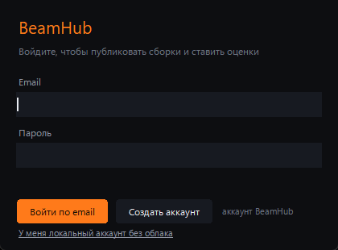

# Подключение Supabase

BeamHub работает и без облака: аккаунты, сборки и отзывы хранятся локально.
Облако нужно, чтобы профили и сборки были **общими**, а вход шёл по email.
Всё на бесплатном тарифе Supabase, Google Cloud **не нужен**.

## Быстрый путь: только email (5 минут)

1. [supabase.com](https://supabase.com) → **Start your project** → войти через GitHub или email.
2. **New project**: имя, пароль базы, регион → **Create** → подождать 1–2 минуты.
3. Слева **SQL Editor** → **New query** → вставить целиком файл
   [`schema.sql`](schema.sql) → **Run** (должно быть «Success. No rows returned»).
4. Слева **Authentication** → **Sign In / Providers** → в списке **Email** →
   выключить **Confirm email** (иначе после регистрации придётся подтверждать почту)
   → **Save**.
5. Слева **Project Settings** (шестерёнка) → **API** → скопировать:
   - **Project URL** — вида `https://abcd1234.supabase.co`;
   - **anon public** — длинный ключ в разделе Project API keys.
6. В BeamHub: **Настройки → «Облако (Supabase)»** → вставить оба значения →
   **«Сохранить облако»** → ввести email и пароль → **«Создать аккаунт»**
   (в следующий раз — **«Войти по email»**).

Готово: аккаунт создан, сборки и отзывы синхронизируются.

`service_role` не нужен и вставлять его не следует.

## Если хотите ещё и Google

Необязательно. Google Cloud Console за последний год переехал: OAuth-клиент теперь
создаётся в разделе **Google Auth Platform**, а не в «APIs & Services → Credentials».

1. [Google Cloud Console](https://console.cloud.google.com) → сверху в поиске
   набрать **Google Auth Platform** → открыть.
2. **Branding**: название приложения и email поддержки → **Save**.
3. **Audience**: **External** → **Save**.
4. **Clients** → **Create client** → тип **Web application** →
   в **Authorized redirect URIs** добавить `https://<project>.supabase.co/auth/v1/callback`
   → **Create** → скопировать **Client ID** и **Client secret**.
5. Supabase → **Authentication → Sign In / Providers → Google** → включить,
   вставить ID и Secret → **Save**.
6. Supabase → **Authentication → URL Configuration** → в **Redirect URLs** добавить
   `http://127.0.0.1:8787/api/auth/callback` (и `http://localhost:8787/api/auth/callback`).
7. В BeamHub появится рабочая кнопка «Войти через Google».

## Для игроков — одна кнопка

Если ключи вшиты в сборку (см. ниже), игрок ничего не настраивает:

1. запускает BeamHub;
2. нажимает **«Войти»** вверху справа;
3. вводит email и пароль → **«Создать аккаунт»** (первый раз) или **«Войти по email»**.

Поля Project URL и anon key он не видит вообще: они уже внутри.



## Владельцу: вшить ключи в сборку

Один раз, после создания проекта Supabase:

```bat
py tools\bake_cloud.py https://ваш-проект.supabase.co ВАШ_ANON_KEY
py build_exe.py --onedir
```

Появится `dist\BeamHub\cloud_defaults.json` — он попадёт в архив рядом с `BeamHub.exe`.
После этого у всех, кто скачает сборку, вход работает без настроек.

Ключ **anon** публичный, его не страшно распространять: доступ к данным закрывают
RLS-политики из [`schema.sql`](schema.sql). **service_role** вшивать нельзя ни в коем случае.

## Вход через Discord (необязательно)

1. [Discord Developer Portal](https://discord.com/developers/applications) → **New Application**.
2. Слева **OAuth2** → скопировать **Client ID** и **Client Secret**.
3. Там же **Redirects** → **Add Redirect** → `https://<project>.supabase.co/auth/v1/callback`
   → **Save Changes**.
4. Supabase → **Authentication → Sign In / Providers → Discord** → включить,
   вставить Client ID и Secret → **Save**.
5. Supabase → **Authentication → URL Configuration → Redirect URLs** → добавить
   `http://127.0.0.1:8787/api/auth/callback`.

В BeamHub появятся кнопки «Войти через Google» и «Войти через Discord».
Discord **не заменяет** Supabase: аккаунт и общие данные всё равно живут в проекте Supabase,
Discord — только способ подтвердить, кто вы.

## Текущий проект

В релизных сборках уже вшит проект `gbibqtdjipiqzaarbrpd.supabase.co`
(файл `cloud_defaults.json` рядом с `BeamHub.exe`). Игрокам ничего вводить не нужно.

Если проект нужно сменить: выполнить `py tools\bake_cloud.py <новый url> <новый publishable-ключ>`,
пересобрать `py build_exe.py --onedir` и выпустить новую версию.

Секретный ключ (`sb_secret_…`) в сборку не попадает и не должен: приложению он не нужен.

## Что синхронизируется

- профиль и вход (email/пароль или Google);
- сборки и их состав, комментарии, оценки;
- жалобы и журнал модерации — только для модераторов.

Локальные аккаунты остаются запасным вариантом и работают без интернета.

